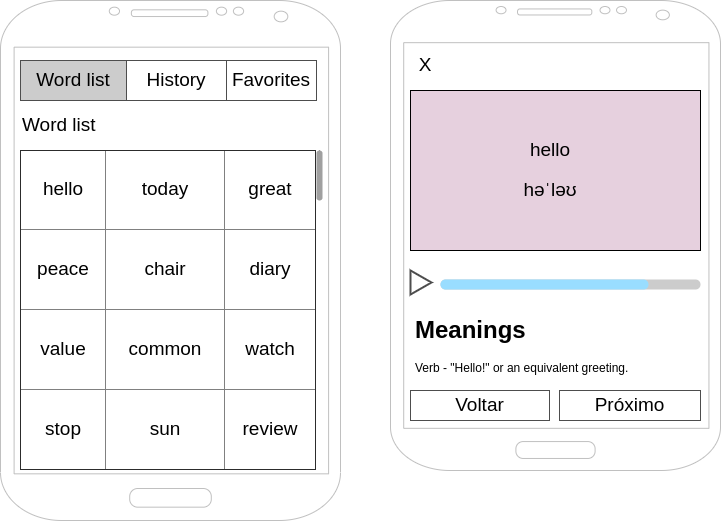

# Mobile Challenge 20240202

## Introdução

Este é um teste para que possamos ver as suas habilidades como Mobile Developer.

Nesse desafio você deverá desenvolver um aplicativo para listar palavras em inglês, utilizando como base a API [Free Dictionary API](https://dictionaryapi.dev/). O projeto a ser desenvolvido por você tem como objetivo exibir termos em inglês e gerenciar as palavras visualizadas, conforme indicado nos casos de uso que estão logo abaixo.

[SPOILER] As instruções de entrega e apresentação do challenge estão no final deste Readme (=

### Antes de começar

- Considere como deadline da avaliação a partir do início do teste. Caso tenha sido convidado a realizar o teste e não seja possível concluir dentro deste período, avise a pessoa que o convidou para receber instruções sobre o que fazer.
- Documentar todo o processo de investigação para o desenvolvimento da atividade (README.md no seu repositório); os resultados destas tarefas são tão importantes do que o seu processo de pensamento e decisões à medida que as completa, por isso tente documentar e apresentar os seus hipóteses e decisões na medida do possível.

### Instruções iniciais obrigatórias

- Utilize as seguintes tecnologias:

#### Tecnologias (Mobile):

- Nativo ou Hibrido (Flutter, Ionic, React Native, etc)
- Estilização (Material, Semantic, etc). Ou escrever o seu próprio sob medida 👌
- Gestão de dados (Redux, Context API, IndexedDB, SQLite, etc)

Atente-se, ao desenvolver a aplicação mobile, para conceitos de usabilidade e adeque a interface com elementos visuais para os usuários do seu sistema.

#### Tecnologias (Back-End):

- Firebase, Supabase, etc

#### Organização:

- Aplicação de padrões Clean Code
- Validação de chamadas assíncronas para evitar travamentos

### Modelo de Dados:

Conforme indicado na documentação da API, a API retorna as informações de uma palavra, tais como etimologia, sinônimos, exemplos de uso, etc. Utilize os campos indicados na documentação dos endpoints para obter os dados necessários.

### Front-End:

Nessa etapa você deverá desenvolver uma aplicação móvel nativa ou hibrida para consumir a API do desafio.

**Obrigatório 1** - Você deverá atender aos seguintes casos de uso:

- Como usuário, devo ser capaz de visualizar uma lista de palavras com rolagem infinita
- Como usuário, devo ser capaz de visualizar uma palavra, significados e a fonética
- Como usuário, devo ser capaz de salvar a palavra como favorito
- Como usuário, devo ser capaz de remover a palavra como favorito
- Como usuário, devo ser capaz de visitar uma lista com as palavras que já vi anteriormente

A API não possui endpoint com a lista de palavras. Essa lista pode ser carregada em memória ou ser salva em banco de dados local ou remoto (por exemplo, com Firebase). Será necessário usar o [arquivo existente dentro do projeto no Github](https://github.com/dwyl/english-words/blob/master/words_dictionary.json).

**Obrigatório 2** - Salvar em cache o resultado das requisições, para agilizar a resposta em caso de buscas com parâmetros repetidos.

**Obrigatório 3** - Seguir o wireframe para a página de listagem dos dados. Pode-se alterar a posição dos itens, mantendo as funcionalidades solicitadas.



**Diferencial 1** - Implementar um tocador de audio utilizando, por exemplo, https://responsivevoice.org/api ou recursos nativos;

**Diferencial 2** - Utilizar alguma ferramenta de Injeção de Dependência;

**Diferencial 3** - Escrever Unit Tests ou E2E Test. Escolher a melhor abordagem e biblioteca;

**Diferencial 4** - Implementar login com usuário e senha e associar os favoritos e histórico ao ID do usuário, salvando essa informação em banco de dados local ou remoto

## Readme do Repositório

- Deve conter o título do projeto
- Uma descrição sobre o projeto em frase
- Deve conter uma lista com linguagem, framework e/ou tecnologias usadas
- Como instalar e usar o projeto (instruções)
- Não esqueça o [.gitignore](https://www.toptal.com/developers/gitignore)
- Se está usando github pessoal, referencie que é um challenge by coodesh:

> This is a challenge by [Coodesh](https://coodesh.com/)

## Finalização e Instruções para a Apresentação

1. Adicione o link do repositório com a sua solução no teste
2. Verifique se o Readme está bom e faça o commit final em seu repositório;
3. Envie e aguarde as instruções para seguir. Caso o teste tenha apresentação de vídeo, dentro da tela de entrega será possível gravar após adicionar o link do repositório. Sucesso e boa sorte. =)

## Solução implementada

This is a challenge by [Coodesh](https://coodesh.com/).

Aplicativo para consultar palavras em inglês, ver significado e fonética, ouvir a pronúncia quando a API oferece áudio, e guardar favoritos e histórico por usuário.

### Stack

- React Native, Expo e Expo Router
- TypeScript
- NativeWind
- Zustand
- Supabase Auth e PostgreSQL, via REST
- Axios
- TanStack Query v5
- Jest e React Native Testing Library
- expo-audio

### Funcionalidades

- Login com e-mail e senha, sessão protegida e logout
- Lista de palavras em grade de três colunas, com paginação e rolagem infinita
- Detalhe da palavra, com fonética, classes gramaticais, definições e exemplos
- Voltar e Próximo dentro da ordem da lista de onde a palavra foi aberta
- Favoritar e desfavoritar, com a estrela acompanhando a palavra atual
- Histórico gravado ao abrir uma palavra, com listagem e remoção
- Estados de carregamento, erro e vazio
- Pronúncia com play, pause, progresso e nova tentativa quando o áudio não carrega

### Organização

- `src/app`: rotas públicas, grupo autenticado e tela `/words/[word]`
- `src/modules/authentication`: sessão, login, logout e cache privado
- `src/modules/home`: lista, histórico e favoritos
- `src/modules/details`: consulta, apresentação, áudio, favorito da palavra e navegação
- `src/shared`: componentes e utilitários reutilizados

A rota só compõe a tela. Serviços acessam as APIs, hooks concentram estado e apresentação, e componentes permanecem declarativos.

### Lista de palavras

A Free Dictionary API não entrega a lista. O app lê a tabela `words` do Supabase, em ordem `word.asc`, com paginação. O arquivo `words_dictionary.json` não está neste repositório e não há script de carga. A tabela remota precisa existir e estar preenchida antes de usar a Home.

### Free Dictionary API

O detalhe usa `GET https://api.dictionaryapi.dev/api/v2/entries/en/{word}`. O resultado fica no cache do TanStack Query, na chave `["word-details", word]`. Essa chamada não recebe o token do Supabase. Fonética, áudio, definição e exemplo são opcionais na resposta e só aparecem quando existem.

### Navegação entre palavras

Home, History e Favorites abrem `/words/[word]` com o parâmetro `source`: `word-list`, `history` ou `favorites`. O hook `useWordNavigation` lê as páginas já carregadas dessa lista no cache e mantém a ordem original durante a visita. Voltar e Próximo usam `router.setParams`, então o X continua fechando a tela com `router.back()`.

Sem `source`, ou quando a palavra não está nas páginas carregadas, os dois botões ficam desabilitados. A próxima página não é buscada só para habilitar o botão. Abrir outra palavra grava o histórico, atualiza o favorito e recria o player.

### Pronúncia

O player tenta a URL devolvida pela API. Enquanto carrega, mostra o indicador. Se o `expo-audio` reportar erro, ou se passar 10 segundos sem carregar, o indicador vira retry e a mesma URL é pedida de novo. Trocar de palavra interrompe o áudio anterior. Não há outra API nem outro host de áudio. Arquivos externos podem continuar indisponíveis.

### Diferenciais do desafio

- Player de pronúncia com `expo-audio`
- Testes de unidade com Jest e React Native Testing Library
- Login com usuário e senha, com favoritos e histórico associados ao ID no Supabase

Não foi adicionada uma ferramenta de injeção de dependência. Os módulos são compostos por import direto.

### Limitações conhecidas

- O access token não é renovado. Quando expira, a sessão local encerra.
- Voltar e Próximo só conhecem palavras já carregadas na lista de origem.
- A disponibilidade do áudio depende do servidor indicado pela Free Dictionary API.
- A lista inicial depende da tabela `words` no Supabase. Este repositório não versiona o `words_dictionary.json`.
- O pacote `@supabase/supabase-js` está instalado, mas o login não usa o SDK.

## Autenticação

O login usa o Supabase Auth pela API REST (`POST /auth/v1/token?grant_type=password`), com Axios, Zustand e `expo-secure-store`. O SDK `@supabase/supabase-js` não faz parte desse fluxo. A chave usada no app é somente a publishable key. A `service_role` não entra no cliente.

A renovação automática de token ficou de fora de propósito. O diferencial do desafio pede login com usuário e senha e a vinculação de favoritos e histórico ao ID do usuário. Não pede refresh token, rotação nem sessão renovada em background. Quando o access token expira, o app encerra a sessão local e o usuário entra de novo.

### Arquitetura

- `sign-in.service` envia e-mail e senha e devolve o payload do Supabase.
- `mapAuthResponse` valida esse payload e monta a sessão só com access token, `expiresAt` em segundos e o usuário (`id`, `email`). O `refresh_token` da resposta é ignorado e nunca é gravado.
- `session-storage` valida, grava, lê e apaga essa sessão no SecureStore. O Zustand não acessa o SecureStore diretamente.
- `useAuthStore` decide o estado da sessão: `loading`, `authenticated` ou `unauthenticated`.
- `useSignIn` só navega depois que `completeSignIn` persiste a sessão e o status fica `authenticated`.
- `getAuthenticatedApi()` em `authenticated-api.ts` é um cliente Axios separado para dados privados. O cliente público das palavras não recebe `Authorization`.
- O grupo `(app)` continua protegido por status no layout. `Stack.Protected` não existe no Expo Router 58.0.30 instalado, então a proteção segue com `Redirect` e `Stack`.

Não há `isLoading` separado. A tela de espera usa `status === "loading"`.

### Fluxo de login

1. O formulário valida e-mail e senha com React Hook Form e Zod.
2. `signIn` chama `POST /auth/v1/token?grant_type=password`.
3. A resposta só vira sessão se tiver access token, usuário e expiração utilizáveis. HTTP 200 sem esse contrato não autentica.
4. A sessão é gravada no SecureStore.
5. O Zustand muda para `authenticated`.
6. A navegação libera o grupo `(app)`.

### Persistência

A sessão fica em um item do SecureStore (`dictionary.auth.session`): access token, expiração e usuário. Senha e refresh token não entram nesse JSON.

Um formato antigo, com chaves separadas para access token, refresh token e metadados, não é restaurado. Na leitura, esse conteúdo é apagado. Um JSON novo que ainda traga refresh token também é descartado.

No iOS, a acessibilidade é `WHEN_UNLOCKED_THIS_DEVICE_ONLY`, então o item não entra no backup para outro aparelho. O Keychain do iOS pode sobreviver à desinstalação. Um identificador de instalação, sem token e sem senha, fica no AsyncStorage. Se o app for reinstalado, esse identificador some e a sessão antiga do Keychain é apagada. No Android, o armazenamento seguro é removido com o app.

Se o SecureStore não estiver disponível, a sessão não é gravada e o usuário não entra.

As escritas passam por uma fila. Cada login ou logout incrementa uma geração. Uma gravação antiga que termina depois confere a geração de novo e não restaura a sessão. Um logout também não apaga uma sessão mais nova, gravada por outro login que já avançou a geração.

Tokens não são escritos em log.

### Expiração

`expiresAt` vem de `expires_at` do Supabase, em segundos. Se a resposta trouxer esse valor em milissegundos, ele é convertido. Se `expires_at` não vier, a expiração é calculada com `expires_in`.

A sessão é considerada expirada quando `Date.now() >= expiresAt * 1000`. Essa checagem acontece:

- ao abrir o app e ler o SecureStore;
- antes de cada requisição autenticada;
- quando o app volta para o primeiro plano;
- quando uma requisição ao Supabase responde HTTP 401;
- por um timer local, que só antecipa o mesmo logout e não é o único mecanismo, porque o sistema pode suspender timers.

Sessão expirada ou inválida é removida. As rotas privadas fecham e a tela de login volta. Não há renovação automática nem manual.

HTTP 401 de uma API externa, como a Dictionary API, não encerra a sessão do Supabase. O access token também não é enviado para essas APIs.

### Logout

O logout zera a sessão em memória antes de qualquer rede. A geração muda na hora, então uma gravação ou restauração pendente não traz o usuário de volta. Em seguida o app cancela as queries privadas, remove o cache cujo prefixo é `user`, apaga o SecureStore e tenta `POST /auth/v1/logout`.

Falha de rede nessa revogação não desfaz o logout local.

### Rotas

- `loading`: o `AuthGate` mostra carregamento e não monta a rota privada.
- `unauthenticated`: só a rota pública de login.
- `authenticated` com token válido: libera o grupo `(app)`.
- Sessão expirada: bloqueia as rotas privadas e volta para `/sign-in`.
- Login concluído: permite a Home.
- Logout: retorna ao Sign In.

A proteção de navegação não substitui as políticas RLS do Supabase.

### Axios

O cliente público continua responsável pela lista de palavras e não leva o token do usuário.

O cliente autenticado aponta para o REST do Supabase e envia:

```http
Authorization: Bearer ACCESS_TOKEN
apikey: SUPABASE_PUBLISHABLE_KEY
```

Antes do envio, ele pede `getValidAccessToken()`. Token ausente ou expirado não é enviado. Não há interceptor de refresh e a requisição não é repetida para tentar renovar o token. Um HTTP 401 do próprio Supabase encerra a sessão.

Favoritos e histórico já usam essa sessão. As consultas privadas ficam em `authenticatedQueryKey(userId, ...)`, com prefixo `user`. Os serviços enviam `Authorization: Bearer` no cliente Supabase compartilhado. `getAuthenticatedApi()` continua disponível, mas não é o cliente chamado por esses fluxos.

### Cache

O `QUERY_CLIENT` é único. No logout e na troca de usuário, as queries privadas em andamento são canceladas e as chaves que começam com `user` são removidas. Uma query privada de outro usuário que tente repovoar o cache depois disso é descartada.

As consultas públicas de palavras permanecem. O cancelamento e a remoção ficam restritos ao prefixo `user`.

### Variáveis de ambiente

Copie `.env.example` para `.env`:

```bash
EXPO_PUBLIC_SUPABASE_URL=https://PROJECT.supabase.co
EXPO_PUBLIC_SUPABASE_PUBLISHABLE_KEY=sb_publishable_...
```

As duas variáveis são obrigatórias. Não coloque a secret key no app.

### Erros

- Credencial inválida: mensagem genérica de e-mail ou senha.
- HTTP 429: pede para tentar mais tarde.
- Falha ao gravar a sessão: o login não navega e o status não fica `authenticated`.
- Access token expirado ou rejeitado pelo Supabase: logout local e retorno ao login.
- Falha ao apagar o SecureStore no logout: o app tenta de novo e mantém a sessão zerada em memória.

### Limitações

- Não existe renovação de access token. O tempo de sessão é o `expires_in` devolvido pelo Supabase, em geral uma hora. Depois disso o usuário precisa entrar outra vez.
- O app não mantém o usuário logado além dessa expiração, mesmo que a rede volte.
- Um timer pode ser suspenso com o app em segundo plano. Por isso a expiração também é conferida na abertura, no retorno ao primeiro plano e antes de cada chamada privada.
- O valor do SecureStore no iOS fica em torno de 2048 bytes. A sessão simplificada cabe nesse limite para um JWT comum. Se a gravação falhar, o login não é concluído.
- A proteção de rotas no cliente não substitui RLS no Supabase.
- Voltar e Próximo não atravessam uma página que ainda não foi carregada.
- O áudio pode falhar mesmo com uma URL válida, porque o arquivo é servido fora deste projeto.

### Como executar

Node `>=24.15.0` e npm `>=11.12.1`.

```bash
npm install
cp .env.example .env
npm start
```

`npm run android`, `npm run ios` e `npm run web` abrem o mesmo projeto nas plataformas correspondentes.

```bash
npm test
npm run test:coverage
npm run test:ci
npm run typecheck
```

`npm run lint` chama `expo lint`. O repositório não inclui configuração nem dependência do ESLint; o comando do Expo tenta instalá-las na primeira execução.

Os testes usam Jest e `@testing-library/react-native`.

O Supabase precisa das tabelas `words`, `word_history` e `favorites`, com RLS alinhado ao usuário autenticado. O app seleciona `word` na lista, `user_id, word, last_viewed_at` no histórico e `user_id, word, created_at` nos favoritos.

## Suporte

Para tirar dúvidas sobre o processo envie uma mensagem diretamente a um especialista no chat da plataforma.
